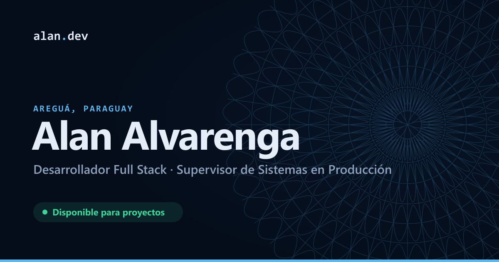
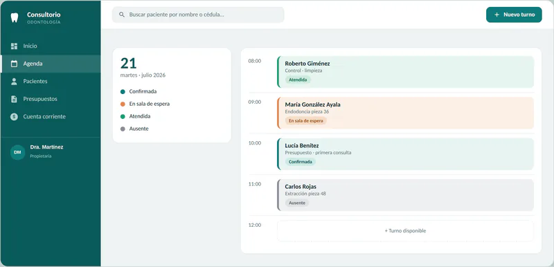
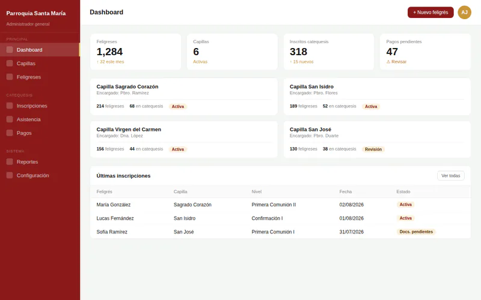
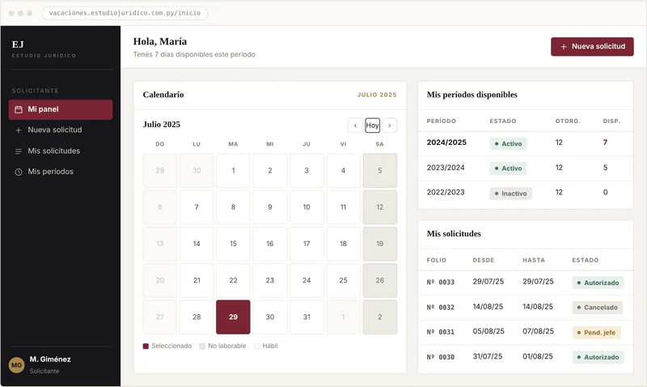

# alan.dev — Portafolio de Alan Alvarenga



Portafolio personal de **Alan Alvarenga**, desarrollador full stack y supervisor de sistemas en producción en Areguá, Paraguay. Muestra sistemas de gestión web reales, construidos a medida y funcionando en producción, con casos de estudio de cada uno.

**🌐 Sitio:** [alanalvarenga.dev](https://alanalvarenga.dev)

## Qué tiene

- **Hero tipo consola de monitoreo:** panel de estado en vivo, contadores y una terminal que escribe el último despliegue.
- **Ñandutí generado en `<canvas>`:** el encaje paraguayo se teje en pantalla. Respeta el tema claro/oscuro y la densidad de pantalla.
- **Casos de estudio** de cada proyecto: problema, solución, decisiones técnicas y capturas anotadas sobre fondo de plano técnico, con líneas que se dibujan hacia cada detalle y un visor ampliado navegable con teclado.
- **Tema claro, oscuro o del sistema**, sin parpadeo al cargar.
- **Formulario de contacto** con Netlify Forms: validación, anti-spam y envío sin recargar.
- **Accesible:** foco visible, contraste AA, navegación completa con teclado y respeto por `prefers-reduced-motion`.
- **SEO:** Open Graph, datos estructurados (JSON-LD), sitemap y code splitting.

## Capturas de los proyectos

| Sistema odontológico | Sistema parroquial | Vacaciones y permisos |
|---|---|---|
|  |  |  |

> Los sistemas son de uso interno: su código es privado por confidencialidad de cada cliente y las capturas usan datos de prueba. Este repositorio contiene solo el portafolio.

## Stack

- [React 19](https://react.dev) + [TypeScript](https://www.typescriptlang.org) (modo estricto)
- [Vite](https://vite.dev)
- [Tailwind CSS v4](https://tailwindcss.com), con tokens de diseño en variables CSS
- [React Router](https://reactrouter.com)
- [Framer Motion](https://motion.dev), con `LazyMotion` para un bundle más liviano
- [sharp](https://sharp.pixelplumbing.com) para optimizar imágenes y generar la imagen de vista previa
- [Netlify](https://www.netlify.com): hosting y formularios

## Cómo correrlo

Requiere Node.js 22 o superior.

```bash
npm install
npm run dev        # servidor de desarrollo en http://localhost:5173
npm run build      # build de producción en dist/
npm run preview    # sirve el build de producción
```

Scripts auxiliares:

```bash
npm run images     # convierte las capturas originales a WebP (1600px + 800px)
npm run og         # genera public/og-image.png y los favicons PNG
```

## Estructura

```
src/
  components/   componentes reutilizables (Nanduti, AnnotatedShot, Lightbox, ContactForm…)
  sections/     una sección de la página principal por archivo
  pages/        Home, ProjectPage, NotFound
  data/         todo el contenido del sitio, tipado
  hooks/        tema, sección activa, contadores, máquina de escribir…
  styles/       tokens de diseño y estilos base
  assets/       capturas de los proyectos en WebP
scripts/        optimización de imágenes y generación de la imagen OG
```

Todo el texto del sitio vive en `src/data/`. Para cambiar una frase se edita el dato, no el componente.

## Contacto

- LinkedIn: [alan-alvarenga-ojeda](https://www.linkedin.com/in/alan-alvarenga-ojeda)
- GitHub: [Ing-Alan](https://github.com/Ing-Alan)
- O desde el formulario de [alanalvarenga.dev](https://alanalvarenga.dev/#contacto)
